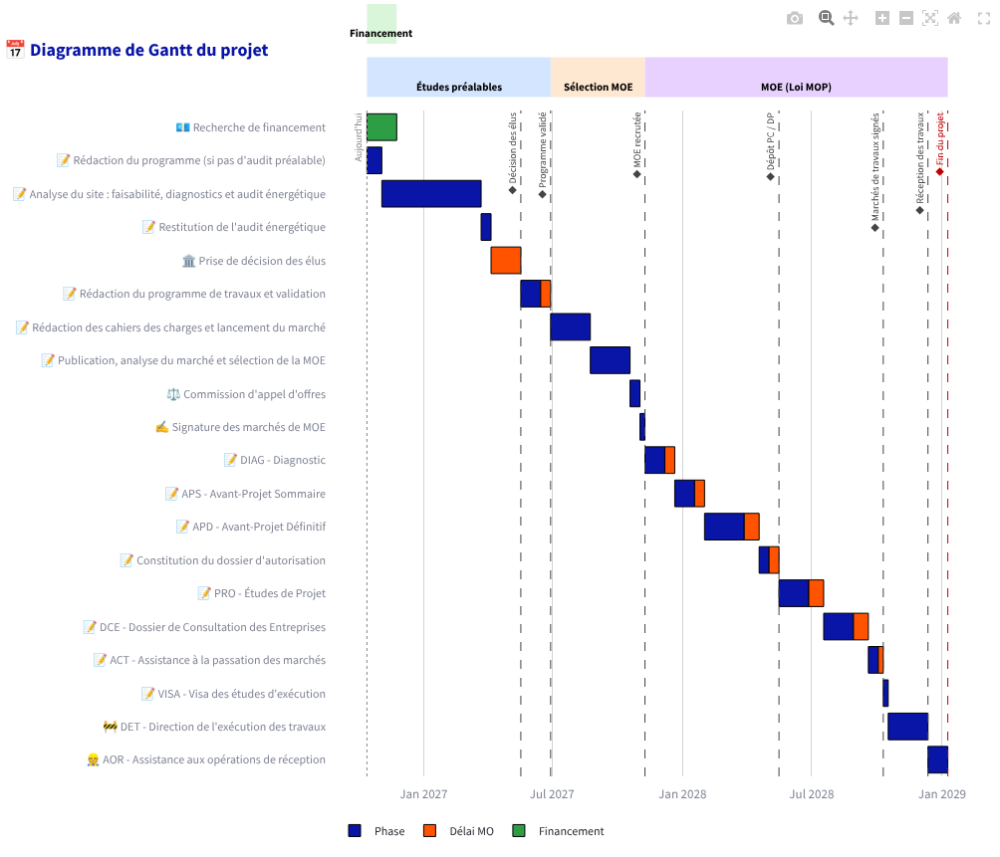

# Planificateur de rénovation énergétique — v2

Application **Streamlit** qui aide un maître d'ouvrage public à planifier un projet de
rénovation énergétique : études préalables, AMO programmiste, recrutement de la maîtrise
d'œuvre puis phases de la **loi MOP** (DIAG → APS → APD → PRO → DCE → ACT → VISA → DET → AOR).

Cette version est une refonte du projet
[Projet_renovation_Gantt](https://github.com/benjaminlallemand44/Projet_renovation_Gantt).



## Lancer l'application

```bash
pip install -r requirements.txt
streamlit run app.py
```

Pour développer (tests et linter) :

```bash
pip install -r requirements-dev.txt
pytest
ruff check . && ruff format --check .
```

Tests dans un vrai navigateur (saisie des tableaux, exports, enregistrement / rechargement d'un scénario) :

```bash
playwright install chromium
pytest tests_navigateur
```

Déploiement sur [Streamlit Community Cloud](https://share.streamlit.io) : choisir ce dépôt et le
fichier `app.py`.

## Fonctionnalités

- **5 états de départ** du projet : de « pas encore d'audit » à « MOE sélectionnée ».
- **Région et département** : ils nomment les lignes « Région » et « Département » du plan de financement et
  fixent le calendrier scolaire. En métropole, les vacances d'été sont les mêmes pour les zones A, B et C (les zones
  ne jouent que pour l'hiver et le printemps) ; pour la Corse et l'outre-mer, les dates se saisissent à la main.
- **Durées modifiables** (en semaines), avec les minimums réglementaires (APS ≥ 3, APD ≥ 6, PRO ≥ 4).
- **Délais de validation du maître d'ouvrage** affichés en orange, et modifiables (option de la barre latérale).
- **Dossiers de financement** (DETR, DSIL, Fonds vert…) montés après l'APD (ou dès le début) : les marchés de
  travaux ne sont pas signés avant l'accusé de dossier complet, la signature valant commencement d'exécution.
- **Recrutement du contrôleur technique et du CSPS** en parallèle du DIAG ; le dépôt du dossier d'autorisation
  l'attend.
- **Attentes visibles** (en jaune) quand un prérequis n'est pas prêt : autorisation, financement, CT/CSPS.
- **Bâtiment scolaire** : l'outil demande si le bâtiment est scolaire et propose de caler les travaux sur les
  vacances d'été, aux dates officielles du calendrier scolaire (démarrage au début de l'été, ou travaux uniquement l'été, sur plusieurs étés si nécessaire).
  Il indique alors combien de semaines il faudrait gagner en amont pour démarrer un été plus tôt.
- **Garantie de parfait achèvement** : un an après la réception, affichée sans allonger la durée du projet.
- **Autorisation d'urbanisme** (DP, PC, PC d'un ERP, autorisation de travaux ERP) avec son **délai d'instruction
  réglementaire** de droit commun, l'éventuelle majoration pour avis de l'ABF et, en option, la purge du recours
  des tiers. L'instruction se déroule en parallèle des études PRO / DCE ; les travaux attendent l'autorisation, et
  l'attente éventuelle est chiffrée.
- **Trêve de fin d'année** (2 semaines par défaut, jusqu'au 1er janvier) : les phases qui la traversent sont
  prolongées d'autant, tandis que les délais réglementaires continuent de courir.
- **Gantt mis à jour en direct** avec un bandeau par catégorie, les jalons clés (décision des élus,
  MOE recrutée, dépôt du PC/DP, marchés signés, réception, fin du projet) et une ligne « aujourd'hui ».
- **Indicateurs** : date de fin, durée totale, part des délais de validation.
- **Exports** : **PDF A4 paysage prêt à présenter** (Gantt, synthèse, jalons, détail des phases, budget et financement),
  Excel (feuilles Résumé, Planning, Jalons), CSV (compatible Excel FR), **jalons au format agenda (.ics)** pour
  Outlook ou Google Agenda, et image du Gantt (icône 📷).
- **Sauvegarde automatique dans le navigateur** : les saisies (planning et budget) reviennent après un rechargement
  de la page ou une mise à jour de l'application, sur le même ordinateur et le même navigateur. Bouton « Nouveau
  projet » pour tout effacer.
- **Scénarios** : enregistrer ses paramètres (planning et budget) en JSON pour les retrouver sur un autre poste ou
  les partager.
- **Utilisable sur smartphone** : sur un téléphone, Gantt compact (libellés courts, détail au toucher des barres),
  réglages des phases repliés, libellés courts dans les listes et tableaux du budget recentrés sur les montants.
- **Glossaire** complet des phases de la loi MOP (y compris VISA et DET), et définitions affichées au survol des barres.

### Onglet « Budget et financement »

- **Coût de l'opération** à partir du montant estimé des travaux : honoraires de maîtrise d'œuvre, AMO, contrôle
  technique, CSPS, assurance dommages-ouvrage, frais divers, aléas, actualisation (taux et forfaits modifiables),
  en HT, TVA et TTC.
- **Plan de financement** : financeurs (DETR, DSIL, Fonds vert, Région, Département, CEE… et toute autre ligne),
  en taux ou en montant, avec leur statut ; **contrôle du plafond de 80 % d'aides publiques** (participation
  minimale de 20 % du maître d'ouvrage, CGCT art. L1111-10) ; **FCTVA** attendu et **reste à charge net**.
- **Calendrier des demandes d'aide** issu du planning (dépôt après l'APD, dossier complet avant la signature des
  marchés de travaux).
- **Échéancier budgétaire** par année (autorisation de programme et crédits de paiement) : dépenses calées sur le
  Gantt, aides (acompte au démarrage des travaux, solde après la réception), FCTVA selon le régime N, N+1 ou N+2,
  solde cumulé et **besoin de financement maximal**.
- **Hypothèses de trésorerie** modifiables : délai de paiement (30 jours, CCP R2192-10), avance aux entreprises
  (5 %), retenue de garantie (5 %, libérée un an après la réception), versement des aides en avance, acomptes au
  prorata des dépenses et solde après la réception.
- **Export Excel** (synthèse, coût, plan de financement, échéancier), **pages budget dans le PDF** ; le budget est
  enregistré dans le scénario JSON.

## Ce qui change par rapport à la v1

| v1 | v2 |
|---|---|
| Un script unique de 370 lignes | Package `renovation_gantt/` (métier, calcul, graphique, export) séparé de l'interface `app.py` |
| ESQ affichée par erreur sur le Gantt | ESQ masquée comme prévu |
| Définitions vides au survol (recherche dans le glossaire erronée) | Glossaire indexé par identifiant de phase |
| VISA et DET absents du glossaire | Glossaire complet |
| Pas de bandeau ni de délai MO pour l'AMO | Bandeau AMO et délai de validation |
| Gantt effacé à chaque modification (bouton) | Gantt recalculé en direct |
| Tests cassés (modules `config`/`gantt` inexistants) | 136 tests pytest, dont des tests de l'interface (`AppTest`), et 7 parcours dans un vrai navigateur (dont un sur écran de smartphone) (Playwright) |
| README non à jour | README, CI GitHub Actions (Python 3.11 à 3.14), ruff |
| Pas d'export ni de date de fin | Excel, CSV, JSON, jalons, indicateurs |

## Structure

```
app.py                      Interface Streamlit
renovation_gantt/
├── phases.py               États, phases, durées par défaut, glossaire
├── planning.py             Calcul des dates et des jalons (sans Streamlit)
├── charts.py               Diagramme de Gantt Plotly
├── budget.py               Coût de l'opération, plan de financement, FCTVA, échéancier
├── export.py               Excel / CSV / agenda .ics / scénarios JSON
├── excel.py                Mise en forme des classeurs (largeurs, neutralisation des formules)
├── territoires.py          Régions, départements, zones et vacances d'été
├── saisie.py               Bornage des valeurs lues dans un scénario
└── pdf.py                  Export PDF (Gantt matplotlib + mise en page fpdf2)
tests/                      Tests pytest
tests_navigateur/           Parcours de bout en bout dans Chromium (Playwright)
images/                     Logo ACTEE
```

Pour modifier une durée par défaut ou ajouter une phase, il suffit d'éditer
`renovation_gantt/phases.py` : l'interface, le Gantt et les exports suivent automatiquement.

## Durées par défaut

Ordres de grandeur pour une rénovation énergétique de bâtiment public, à ajuster projet par projet :

| Phase | Durée | Validation MO |
|---|---|---|
| Signature des marchés de MOE | 3 sem. | — |
| Recrutement CT / CSPS (en parallèle) | 8 sem. | — |
| DIAG | 6 sem. | 2 sem. |
| APS / APD | 4 / 8 sem. | 2 / 5 sem. |
| PRO / DCE | 5 / 4 sem. | 3 / 2 sem. |
| ACT (consultation, analyse, attribution) | 10 sem. | 2 sem. |
| Période de préparation (VISA) | 6 sem. | — |
| Travaux (DET) | 24 sem. | — |
| AOR | 4 sem. | — |
| Dossiers de financement (jusqu'au dossier complet) | 12 sem. | — |

## Délais réglementaires retenus

| Autorisation | Délai d'instruction | Référence |
|---|---|---|
| Déclaration préalable | 1 mois (+1 mois avec avis ABF) | C. urb. R423-23, R423-24 |
| Permis de construire | 3 mois (+1 mois avec avis ABF) | C. urb. R423-23, R423-24 |
| Autorisation de travaux ERP | 4 mois | Code de la construction et de l'habitation |
| Permis de construire d'un ERP | 5 mois | C. urb. R423-28 |
| Recours des tiers (option) | 2 mois après affichage | C. urb. R600-2 |

Ce sont des délais de droit commun : un dossier incomplet ou des consultations supplémentaires peuvent les
allonger. Ils se modifient dans `renovation_gantt/phases.py`.

## Licence

MIT — voir [LICENSE](LICENSE).
